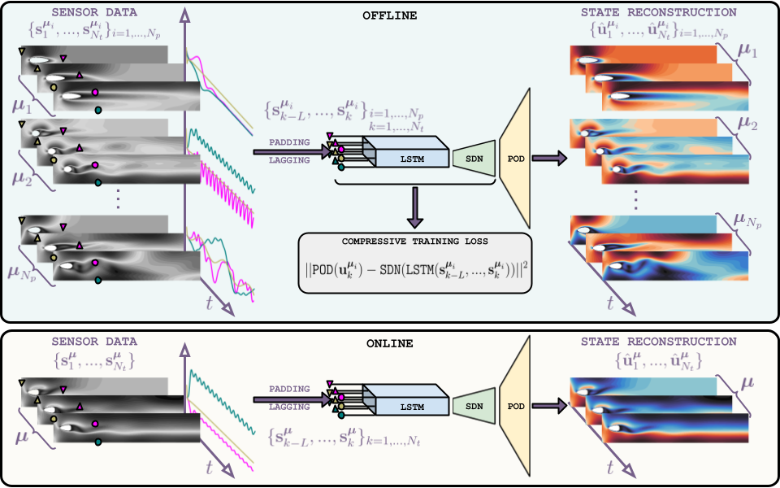
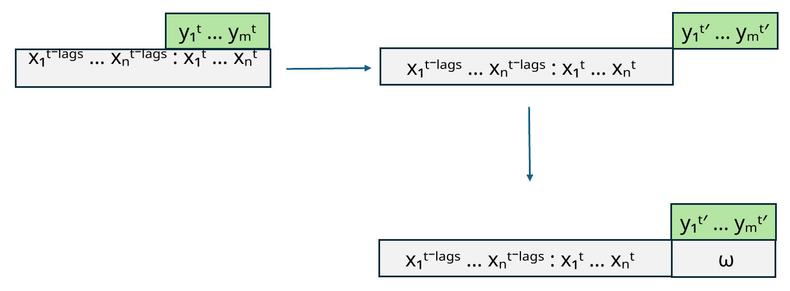

# SHRED-MPC

**Pressure prediction and lift-following control of a rotating cylinder.**

This project uses a control-conditioned Shallow Recurrent Decoder (SHRED) to predict pressure fields from sparse pressure observations and a candidate rotation history. Model predictive control evaluates these histories using a pressure-derived lift observable, applies the first part of the chosen rotation command in OpenFOAM, and repeats with updated observations.



*Upstream SHRED-ROM architecture, reproduced from [Matteo Tomasetto’s repository](https://github.com/MatteoTomasetto/shred-rom) under its [MIT license](website/assets/LICENSE-SHRED-ROM.txt). This illustrates the reconstruction method on which the project builds; the control-conditioned prediction window is shown below.*

## Method

The pressure model pairs an earlier sensor window with the later pressure field and the corresponding rotation input. At each control step, the same sensor history is evaluated with several candidate ramp-and-hold rotation commands. The controller selects a command using lift tracking, oscillation and control-move costs, advances CFD for the control horizon, and updates the history.



*Prediction-window diagram from slide 5 of Andrea Ingrao’s project presentation. The original code’s pressure-derived lift convention is retained; it is not a total-force calculation.*

[Watch the original cylinder-control demonstration](website/assets/cylinder-control.mp4) · [Open the project website](website/index.html)

## Quickstart

Run these commands from this repository’s root. The dataset and trained model are generated locally and are not included.

### Install

The checked environment is Python 3.12, PySHRED 1.0.21, OpenFOAM Foundation 13 and ParaView 5.11.2. `requirements.txt` records the observed Python versions.

```bash
python3 -m venv .venv
source .venv/bin/activate
python -m pip install -r requirements.txt

# Use the path of your OpenFOAM installation.
source /opt/openfoam13/etc/bashrc
command -v blockMesh pimpleFoam foamToVTK pvpython
```

The scripts call `pimpleFoam`; in the checked Foundation 13 installation this invokes `foamRun -solver incompressibleFluid`. ParaView supplies `pvpython` separately from the Python virtual environment. Training alone does not require CFD software. A fresh internet installation has not been tested; checks used the installed versions listed above.

### 1. Generate the dataset

All settings remain in **[`shred_utils/input_var.py`](shred_utils/input_var.py)**. The current setup generates 500 cases with these four control-history families:

```python
DATASET_RAMP_CASES = 200
DATASET_RAMP_HOLD_CASES = 150
DATASET_VARIED_CASES = 100
DATASET_EXTENDED_HOLD_CASES = 50
```

`DATASET_CASES` is their sum. To start with **10 simulations**, change those four values to **4, 3, 2, 1**. Set `DATASET_SEED = 42` to repeat the control tables; the unchanged default `None` draws new histories. Leave `DATASET_DIMENSIONS = -1` to train on all configured cases.

```bash
bash OpenFoam/runDataSet.sh --dry-run  # Print the plan; run no CFD.
bash OpenFoam/runDataSet.sh            # Generate CFD and export pressure CSVs.
```

The launcher uses `OpenFoam/0`, `constant` and `system`, generates a rotation table for each case with `test2.py`, then runs meshing, CFD and CSV export. **The supplied `0/` is the required initial state**, including nonuniform fields; do not replace it with an empty folder. Output goes to `OpenFoam/case_omega*/` and `OpenFoam/CSV_files/case_omega*/`. Each CSV folder contains `datacsv_*.csv` and its `omega_t_table.txt`; `p` is normalized pressure, with raw pressure retained as `p_raw`.

The launcher refuses an existing campaign. For another dataset, move both output groups aside or use a fresh repository copy. The full setup needs substantial disk space and memory; use a small pilot first. The current setup matches the saved campaign’s case count and output timing, but no recorded seed establishes the exact original random trajectories.

### 2. Train the pressure model

Set `shred_epochs`, `shred_device` and, if needed, `shred_pod_compression` in `input_var.py`. Keep the sensor IDs and time-window settings consistent between training and MPC.

```bash
python shred_MPC_test_p.py --train-only --model models/pressure
```

For an existing dataset stored elsewhere:

```bash
python shred_MPC_test_p.py --train-only --model models/pressure \
  --dataset /absolute/path/to/CSV_files
```

Training uses the original pressure-training function. It saves weights, fitted preprocessing/POD transforms, the original initialization history and a settings snapshot under `models/pressure/`. Choose a new model directory for another training run. Only load model folders you created or trust.

### 3. Run the lift-following MPC

```bash
python shred_MPC_test_p.py --model models/pressure --run-dir runs/lift-01
```

This loads the saved model without retraining, copies the supplied `MPC_OpenFoam` case into a new run folder and executes the original control loop. CFD files and the existing controller diagnostic plots stay inside that folder. For another run, use `runs/lift-02`.

Set `N_cycles` and `LIFT_TARGET_SEED` in `input_var.py` to control run length and repeat the generated lift-target sequence. Existing run directories are never overwritten. The initial CFD state and the historical observation-history initialization are preserved; their alignment still needs a full-run scientific check. The supplied CFD dictionaries retain their original `steadyState` setting.

## Files

```text
shred_MPC_test_p.py      Train, save/load, and run pressure-based MPC
shred_utils/            Existing settings and required helper functions
OpenFoam/               Dataset launcher and complete initial CFD case
MPC_OpenFoam/           Initial MPC case and pressure CSV exporter
DataSet_to_CSV.py       Dataset pressure export (called by the launcher)
test2.py                Existing rotation-table generator
requirements.txt       Observed Python dependency versions
tests/                 Dataset and launch checks
website/               Static project page and original visual material
```

No dataset, trained checkpoint, statistical-analysis workflow or experiment archive is included. See [NOTES.md](NOTES.md) for the small launch changes, checks and media credits.

## People

Developed by **Andrea Ingrao**, who carried out the design, implementation and experimental work, with theoretical guidance from **Matteo Tomasetto** and **Prof. Andrea Manzoni**, in the **MOX, Politecnico di Milano** project context. Upstream SHRED-ROM and PySHRED are credited separately from these project contributions.

## Check and preview

```bash
python -m unittest discover -s tests -v
python -m http.server 8000 --bind 127.0.0.1 --directory website
```

Open **http://127.0.0.1:8000/**. The website also opens directly from `website/index.html`. Tests include a tiny synthetic training/save/load check; they do not run CFD. GitHub Pages deployment is manual and remains unapproved. Nothing in this export automatically uploads or publishes.
