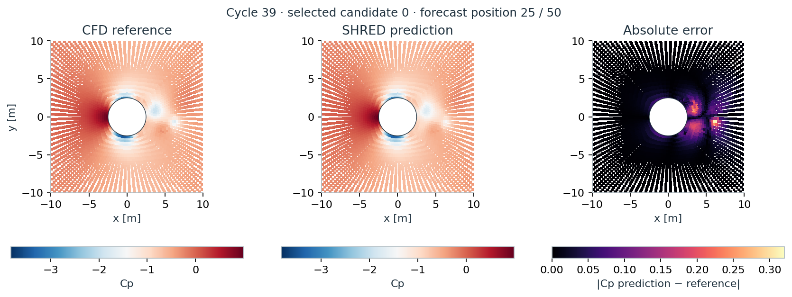
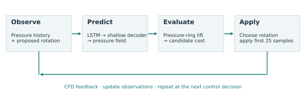
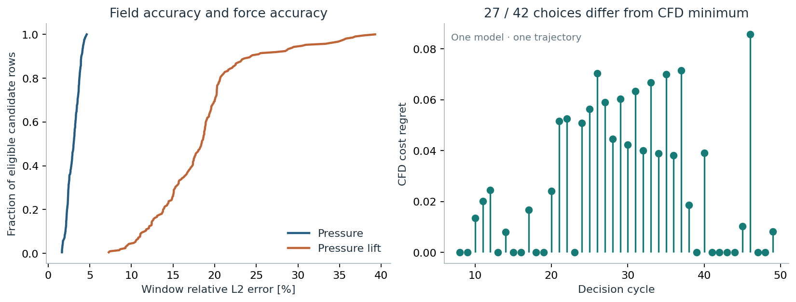

# SHRED-MPC: control-conditioned pressure prediction for cylinder rotation

**Can sparse pressure histories predict the consequences of a rotation command well enough to select a useful control action?** This research prototype combines a control-conditioned Shallow Recurrent Decoder (SHRED) with finite-candidate model predictive control (MPC). OpenFOAM supplies a rotating-cylinder numerical benchmark; the predictor estimates normalized pressure fields, from which a pressure-derived lift observable is computed.


*Real archived fields: July 2026 run, model `training_000`, simulation 0, cycle 39, candidate 0, position 25/50. CFD and prediction share a color scale. The candidate was selected by a documented median-error rule, not visual preference. [Figure provenance](docs/results.md).* 

Developed by **Andrea Ingrao**, with theoretical guidance from **Matteo Tomasetto** and **Prof. Andrea Manzoni**, in the project context of **MOX, Politecnico di Milano**. Source repository: [andreaingrao/SHRED-MPC](https://github.com/andreaingrao/SHRED-MPC) (private; access required). Contact information remains pending. No institutional endorsement or publication status is implied.

## Research question and method

Sparse sensing can reduce the observation burden of a flow controller. The central question here is whether a pressure-field predictor preserves the force response and candidate ranking needed for control. A small field error alone does not answer that question.



1. Combine a history of sparse cell-centre pressure observations with a proposed rotation history.
2. Use an LSTM and shallow decoder to predict compressed pressure coefficients and reconstruct the pressure field. Control is an explicit input; this is a fixed-offset forward-prediction formulation, distinct from same-time reconstruction.
3. Integrate the near-cylinder pressure ring to obtain the **historical pressure-lift observable**. It excludes viscous force and is not a standard total lift coefficient.
4. Score ramp-and-hold candidate controls using mean tracking error, within-window variability and a move penalty. Apply the first 25 samples, update observations, and repeat.

The current implementation uses 50-sample histories and a 50-sample trained offset. The saved July experiment used 12 pressure channels; current defaults use seven. [Method, indexing and physical configuration](docs/method.md).

## Selected evidence

The available archive contains one model and one partial control rollout: 50 decisions with five candidate evaluations each. The following descriptive results use the 42 decisions eligible after the recorded warm-up threshold (`controller_timestep >= 250`). Candidate evaluations within a rollout are correlated.

| Quantity | Result | Interpretation |
|---|---:|---|
| Pressure window relative L2 | Median **3.06%**, IQR 2.38–3.66% | 210 eligible candidate windows; all field points and 50 positions |
| Pressure-lift trajectory relative L2 | Median **18.43%**, IQR 14.89–20.27% | Same windows, historical observable |
| Candidate-choice disagreement | **27 of 42 decisions** | Compared with the minimum CFD cost among the five evaluated candidates |
| Selected CFD cost regret | Median **0.0193** | Absolute difference from that discrete CFD minimum; composite cost units |

Source: `run_20260713_121325_067474`, model `training_000`; [curated CSV](data/curated/candidate_statistics.csv), [metadata and hashes](data/curated/provenance.json), [metrics and selection rules](docs/results.md). IQR describes candidate spread, not confidence or independent-model variability. Relative lift errors are calculated over complete windows; these reference norms are not near zero.



These observations motivate evaluating pressure, force observables and control decisions together. They do not establish superiority over another controller, robustness across independent trainings, or a measured speedup. The slide’s 1,680-candidate panel has no matching source archive here and is not used as evidence.

## My contribution

I designed and implemented the project’s CFD/data workflow, pressure-based SHRED adaptation, candidate-control loop, experiment tooling and analysis. Matteo Tomasetto and Andrea Manzoni provided theoretical guidance. This contribution statement follows Andrea’s account; upstream SHRED architecture and software are credited separately. [People and acknowledgments](docs/credits.md).

## Quick start: inspect real results without CFD or training

Python 3.12.3 was verified. From this repository’s root:

```bash
python3 -m venv .venv
source .venv/bin/activate
python -m pip install -e '.[demo]'
python scripts/verify_curated.py
python scripts/make_figures.py --output runs/demo
```

Open `runs/demo/fields.png` or `runs/demo/decision-quality.svg`. The demo uses about 1.8 MB of real archived data, NumPy and Matplotlib. It does not fit a model or run a solver, and refuses an existing output directory. Add `--animation` if `ffmpeg` is available. The supplied website already includes static figures and a five-second compressed animation.

For the local project website:

```bash
python scripts/build_site.py
python -m http.server 8000 --bind 127.0.0.1 --directory website
```

Open **http://127.0.0.1:8000/**. No backend, external fonts, analytics or network data fetching are used. [GitHub Pages instructions](docs/deployment.md).

## Research workflows

Install `python -m pip install -e '.[research]'` for the PySHRED/Torch workflow. Installed versions were recorded; they are tested environment pins, not claims about minimum compatibility. OpenFOAM and ParaView are separate system dependencies.

```bash
# Safe: generate a complete control table without CFD.
shred-control-table 0 --seed 42 --output runs/omega0.txt

# Safe: plan matched temporal-evaluation scenarios.
shred-temporal --dry-run --run-dir runs/temporal-plan

# Safe: prepare fresh CFD cases/control histories without simulation.
shred-dataset plan --run-dir runs/dataset-plan --cases 10 --seed 42

# Focused software checks (full set needs the research extras).
python -m unittest discover -s tests -v
```

Dataset generation/export, standalone training, explicit MPC execution and temporal evaluation have **separate instructions** in [workflows](docs/workflows.md). Expensive commands require `--execute`; owned run directories isolate simulations. Historical MPC is retained for inspection and explicit isolated execution, with its unresolved initialization issues documented.

## Repository layout

```text
src/shred_mpc/       Maintained configuration, preprocessing, schedules and temporal tools
scripts/            Evidence verification, figure regeneration and website preparation
tests/              Focused numerical, persistence, indexing and isolation checks
configs/            Configuration guide; resolved settings are saved per run
cfd/templates/      Training and MPC inputs, including mesh and boundary dictionaries
data/curated/       Small real result sample, metadata and provenance hashes
docs/               Method, evidence, workflows, audit, credits and release checklist
website/            Buildless GitHub Pages site and optimized scientific assets
archive/            Annotated historical source as non-executable text
LICENSES/           Preserved upstream notices; no project-wide license selected
```

Datasets, trained models and generated runs belong outside source control. [Original-to-export mapping](docs/file-mapping.md) explains every retained family; a machine-readable mapping identifies copied files. The original workspace remains unchanged.

## Status and limits

- **Completed evidence:** the curated July candidate archive and its reproducible offline analysis. No historical trained checkpoint or preprocessing transforms were found, so those forecasts cannot be regenerated by model inference from this export.
- **Implemented, not scientifically evaluated here:** isolated temporal scenario generation, model/transform persistence, repeated training seeds and resumable CFD references.
- **Physical limitation:** current templates specify `steadyState`; October logs confirm SIMPLE steady-state operation. Nominal solver labels must not be interpreted as verified physical transient time. The exact July solver dictionaries were not saved.
- **Further limitations:** pressure-ring force convention, upstream pressure-reference access, historical initialization, restricted initial-state diversity, no mesh/time convergence study or independent controller baseline.
- **Proposed research:** establish a physically interpretable plant, synchronize sensing/control/checkpoints, validate force integration, and evaluate held-out control responses. [Prioritized roadmap](docs/roadmap.md).

The full dataset stays local by choice. The current 500-case dataset is a later regeneration and is not identified as the July model’s training data. Generation code is supplied; public redistribution and a full reproduction campaign remain separate decisions. [Reproducibility boundaries and validation](docs/validation.md).

## Credit and references

The maintained workflow uses [PySHRED](https://github.com/pyshred-dev/pyshred). The older local SHRED code corresponds closely to [SHRED-ROM](https://github.com/MatteoTomasetto/SHRED-ROM); its MIT notice is retained with the archived source. OpenFOAM, ParaView, NumPy, SciPy, scikit-learn, PyTorch and Matplotlib underpin the computation and analysis.

- Williams, Zahn and Kutz, *Sensing with shallow recurrent decoder networks*, Proc. R. Soc. A (2024), [doi:10.1098/rspa.2024.0054](https://doi.org/10.1098/rspa.2024.0054).
- Tomasetto et al., *Reduced order modeling with shallow recurrent decoder networks*, Nature Communications 16, 10260 (2025), [doi:10.1038/s41467-025-65126-y](https://doi.org/10.1038/s41467-025-65126-y).

No novelty priority, DOI, formal project authorship order or publication is claimed. Project-wide licensing remains undecided; see [rights and release decisions](docs/release.md).
